# Lead Intake & CRM Automation

Automated lead intake and CRM workflow built with **n8n** and **HubSpot**.

The workflow receives a lead through an n8n form, checks whether the contact already exists in HubSpot, creates or updates the contact, prepares the correct contact ID for the active branch, creates a new deal, and automatically associates that deal with the corresponding contact.

## Workflow Overview

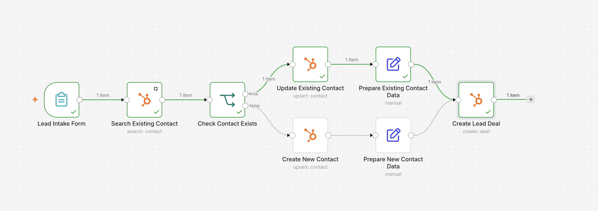

The automation supports two CRM paths:

- **New contact:** creates a HubSpot contact and then creates a linked deal.
- **Existing contact:** updates the existing HubSpot contact and then creates a new linked deal.

This avoids duplicate contacts while ensuring that every submitted lead can generate a properly associated sales opportunity.

## Automation Logic

1. **Lead Intake Form** collects lead details, service interest, estimated budget, company, phone number, and message.
2. **Search Existing Contact** searches HubSpot by email.
3. **Check Contact Exists** routes the workflow depending on whether a matching contact was found.
4. **Create New Contact** creates a CRM record for a new lead.
5. **Update Existing Contact** refreshes CRM data for an existing lead.
6. **Prepare Contact Data** standardizes the contact ID from either branch.
7. **Create Lead Deal** creates a deal in the HubSpot sales pipeline.
8. The deal is automatically **associated with the correct HubSpot contact**.

## New Contact Path

The workflow detects that no matching CRM contact exists and follows the new-contact branch.

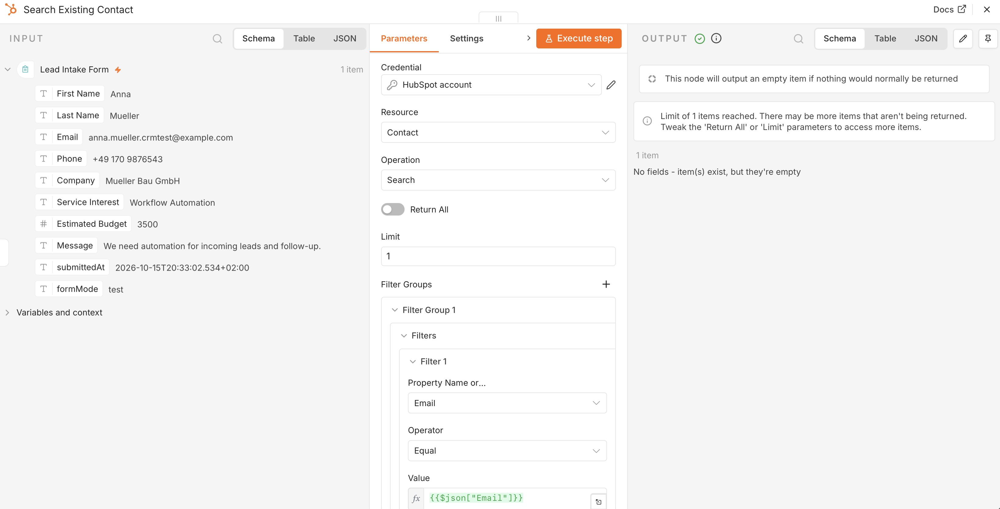

The new HubSpot contact is created successfully:

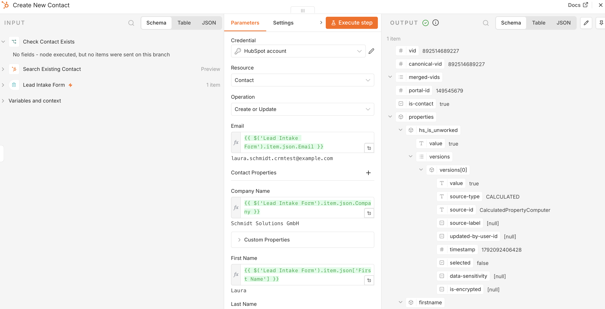

The contact is verified directly in HubSpot:

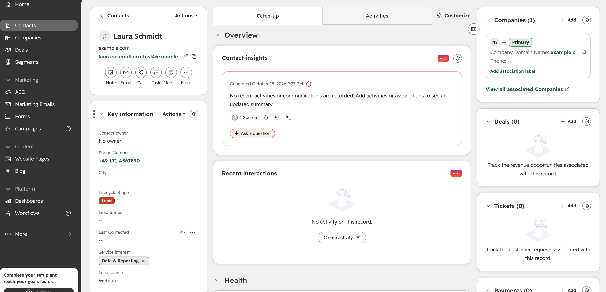

### Complete New Lead Flow

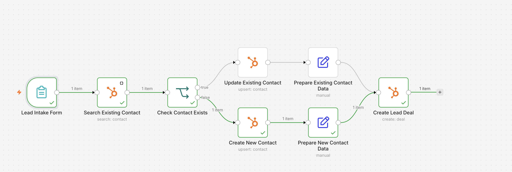

The created deal receives the correct contact association:

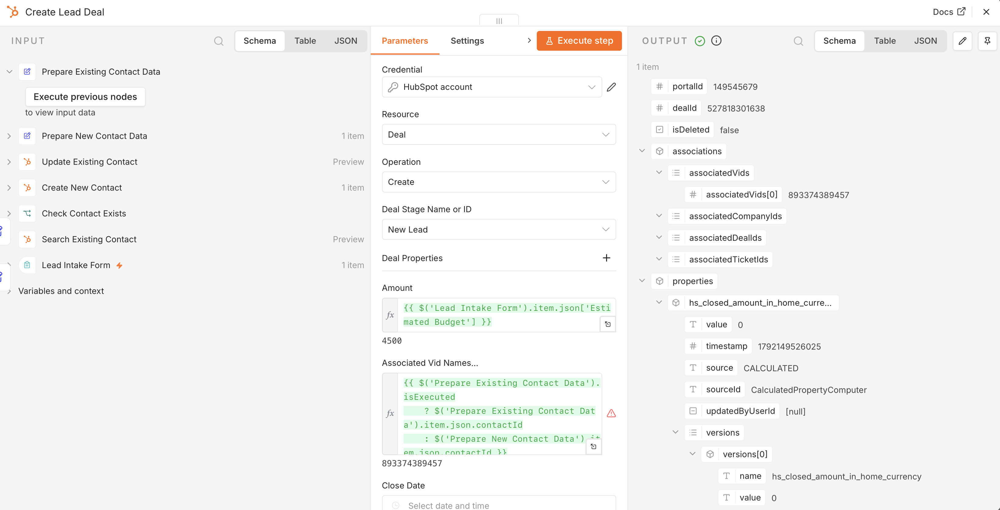

The result is visible in the HubSpot sales pipeline:

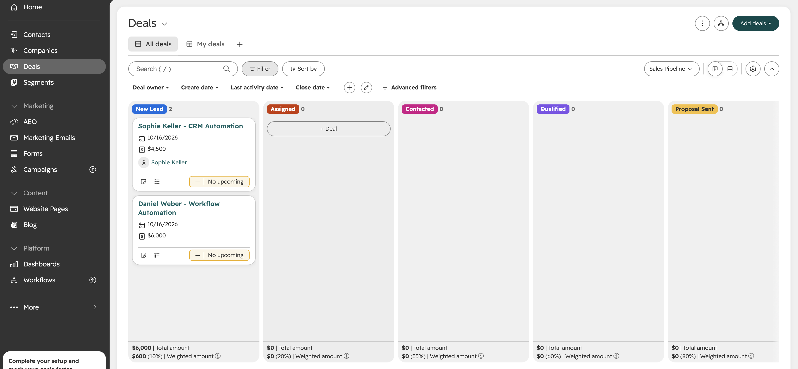

## Existing Contact Path

When a matching email already exists in HubSpot, the workflow follows the existing-contact branch.

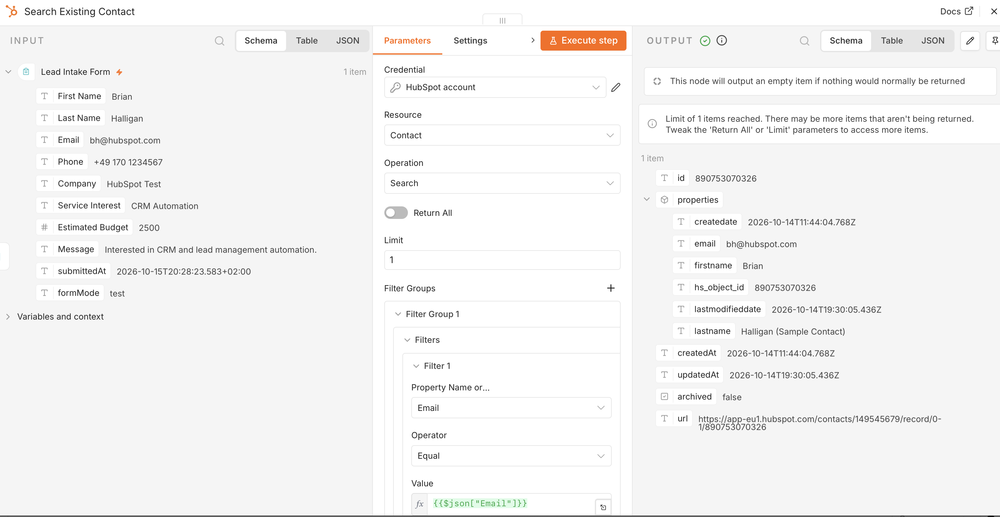

The contact record is updated with the latest submitted data:

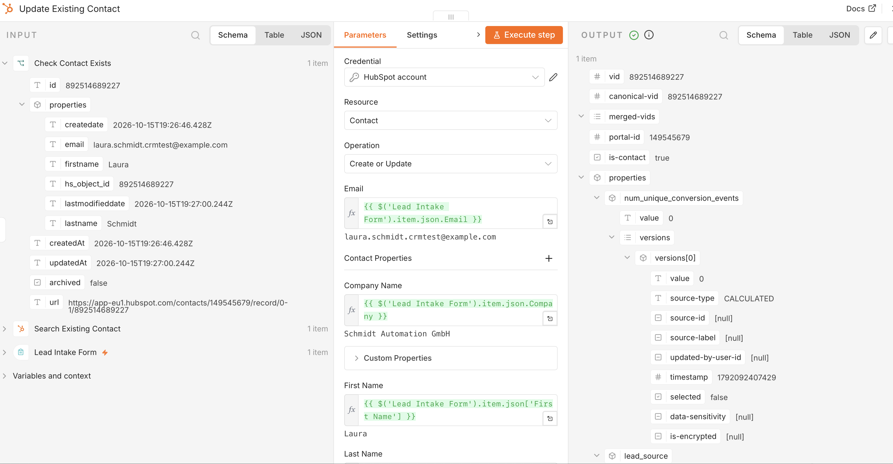

The updated record is verified in HubSpot:

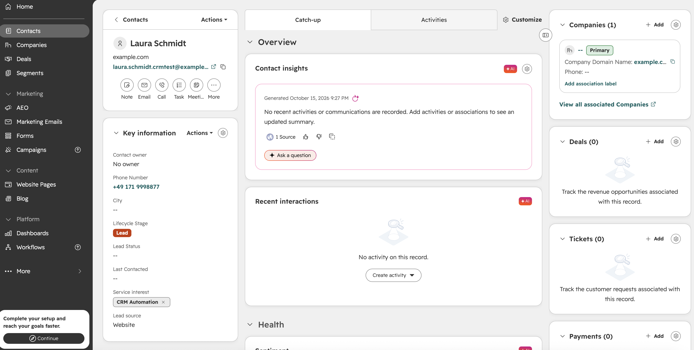

### Complete Existing Contact Flow


The new deal is created and associated with the existing contact:

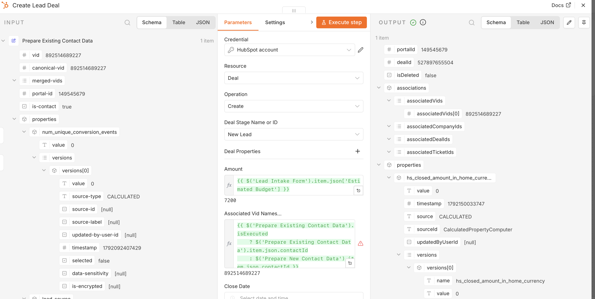

The linked deal is visible in HubSpot:

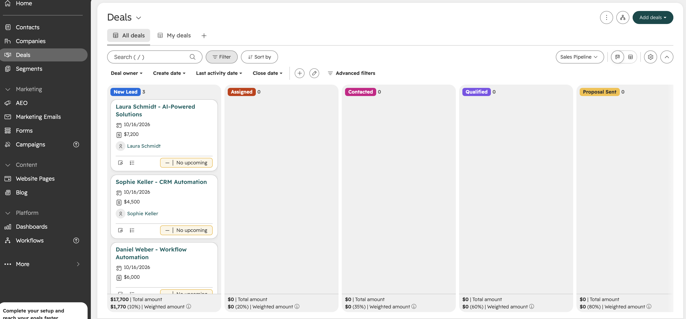

## HubSpot Deal Creation

The workflow creates deals dynamically using submitted lead data such as:

- contact name
- service interest
- estimated budget
- lead source
- pipeline stage

Example deal creation result:

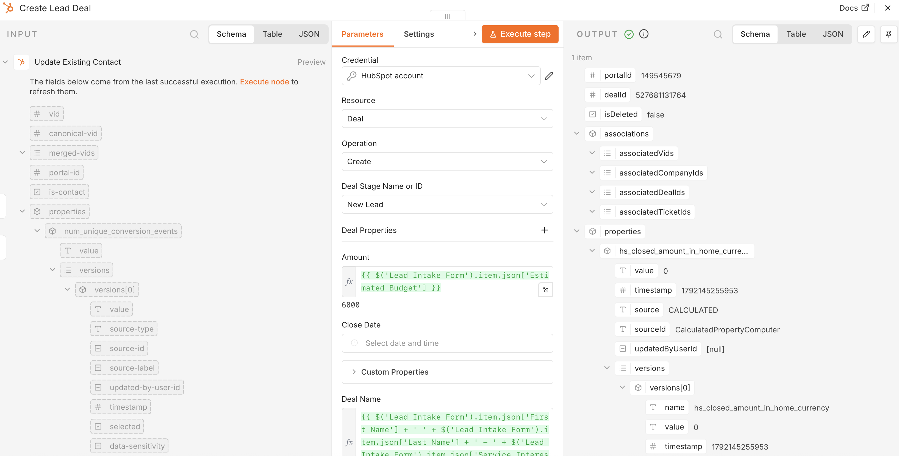

Example HubSpot pipeline result:

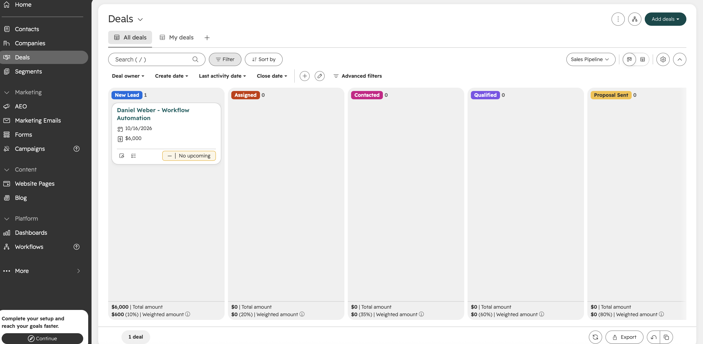

## Key Features

- Lead intake through an n8n form
- HubSpot contact search by email
- Duplicate-contact prevention
- Conditional routing for new and existing contacts
- Contact creation
- Existing contact updates
- Custom HubSpot properties
- Dynamic service-interest mapping
- Dynamic estimated deal value
- Automatic HubSpot deal creation
- Automatic contact-to-deal association
- Separate handling for both CRM branches

## Tech Stack

- **n8n**
- **HubSpot CRM**
- **HubSpot Contacts**
- **HubSpot Deals**
- **Conditional workflow logic**
- **Dynamic expressions and data mapping**

## Business Use Case

This workflow can be used by small businesses, agencies, service companies, consultants, and sales teams that receive leads from forms and want to automate the transfer of lead data into a CRM.

It reduces manual CRM work, prevents duplicate contacts, keeps existing records up to date, and automatically creates sales opportunities linked to the correct customer record.

## Project Structure

```text
.
├── README.md
├── workflow/
│   └── lead-intake-crm-automation.json
└── screenshots/
    ├── 01-search-existing-contact-success.png
    ├── 02-form-to-crm-existing-contact-test.png
    ├── 03-new-contact-not-found.png
    ├── 04-existing-contact-true-branch.png
    ├── 05-create-new-contact-success.png
    ├── 06-hubspot-contact-created-verified.png
    ├── 07-update-existing-contact-success.png
    ├── 08-hubspot-contact-updated-verified.png
    ├── 09-create-lead-deal-success.png
    ├── 10-hubspot-deal-created.png
    ├── 11-new-lead-workflow-success.png
    ├── 12-deal-contact-association-success.png
    ├── 13-hubspot-deal-linked-to-contact.png
    ├── 14-existing-contact-workflow-success.png
    ├── 15-existing-contact-deal-association-success.png
    └── 16-hubspot-existing-contact-deal-created.png
```

## Notes

This repository demonstrates the workflow architecture, CRM logic, conditional routing, HubSpot integration, and verified execution results.

Credentials and private connection data should not be included in the public workflow export.
